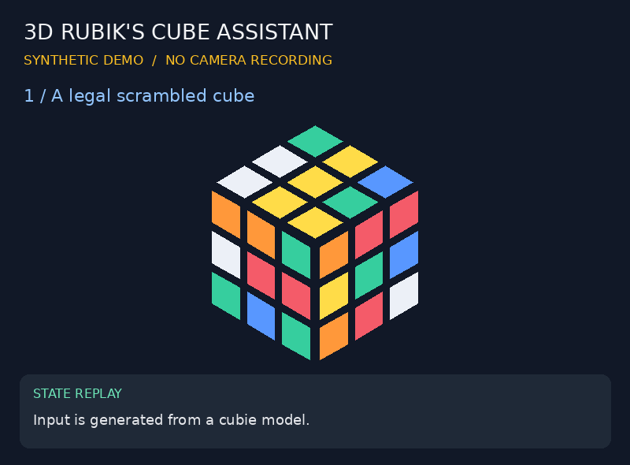
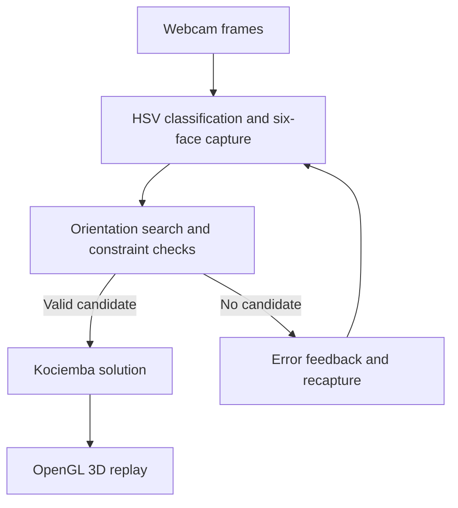

# 3D Rubik's Cube Assistant

A Python application that captures the six faces of a Rubik's Cube with a webcam, reconstructs a physically valid cube state, computes a solution, and replays it in 3D.

**OpenCV · Constraint validation · Orientation search · Kociemba solver · OpenGL · Tkinter**



The GIF illustrates the state-processing and replay logic using synthetic input. For recording the actual application, see the [demo guide](docs/DEMO.md).

## Features

- Classify nine stickers within a fixed 3×3 region using HSV masks and pixel coverage.
- Identify faces by their center colors and handle duplicate captures or unrecognized stickers.
- Search up to **4,096 face-orientation combinations** to handle 90-degree rotations during capture.
- Filter invalid or duplicate cubie color combinations before checking corner orientation, edge orientation, and permutation parity.
- Convert a valid candidate into the external solver's facelet representation.
- Replay and reverse solution steps with a geometric state-update engine and an interactive 3D viewer.

## Pipeline



| File | Responsibility |
|---|---|
| `cube_assistant.py` | Capture UI, color classification, orientation search, physical-state validation |
| `cube_solver.py` | Facelet serialization, external solver integration, move-token handling |
| `gl_simulator.py` | Geometric state updates, rendering, playback, camera controls |
| `tests/test_cube.py` | Legal and impossible states, move consistency, solution replay, synthetic color patches |
| `tools/benchmark.py` | Orientation-search timings and validation counts |
| `tools/make_demo.py` | Synthetic replay GIF generation |

## Installation

The application's camera code uses **Windows DirectShow**. The following commands target Windows PowerShell with Python 3.12. Automated logic tests were run on Linux without opening the camera or GUI; the complete Windows camera/OpenGL workflow still requires local verification.

```powershell
git clone https://github.com/YESTER-H/3D-Rubiks-Cube-Assistant.git
cd 3D-Rubiks-Cube-Assistant
py -3.12 -m venv .venv
.\.venv\Scripts\python.exe -m pip install --upgrade pip
.\.venv\Scripts\python.exe -m pip install -r requirements.txt
.\.venv\Scripts\python.exe cube_assistant.py
```

- Include Tcl/Tk when installing Python. `tkinter` is not installed through pip.
- Building `kociemba` from source may require a C/C++ compiler compatible with your Python installation.
- For Linux logic tests, Tk and OpenGL/GLU shared libraries are also required. If a C-extension build selects an unavailable compiler, an installed GCC can be selected with `CC=gcc CXX=g++`.
- `requirements.txt` specifies dependency ranges. Exact versions used for verification are recorded in [environment.json](results/environment.json) and `requirements-tested.txt`; this snapshot is not a cross-platform compatibility guarantee.

## Capture and controls

1. Align a cube face with the fixed 3×3 guide, facing the camera directly.
2. Check the nine predicted labels and click **Capture**.
3. Rotate the entire cube to capture another face. Do not scramble its layers while collecting the six faces.
4. After capturing all faces, click **Done** to validate the state and compute a solution.
5. Use the arrow keys in the 3D viewer to replay the solution.

The existing capture UI uses Korean button labels: Capture (`캡처하기`), Undo (`되돌리기`), Done (`완료`), and Exit (`종료`).

| Window | Control |
|---|---|
| Capture UI | Capture / Undo / Done / Exit buttons |
| Capture UI | `H`: toggle the central patch's HSV debug display |
| 3D viewer | Right or Up arrow: next quarter-turn |
| 3D viewer | Left or Down arrow: undo the previous quarter-turn |
| 3D viewer | Left mouse drag: orbit; scroll wheel: zoom |
| 3D viewer | `Esc`: close the viewer and return to capture |

The fixed center-color mapping is **U=yellow, R=green, F=red, D=white, L=blue, B=orange**. Only the preview is mirrored; stored labels retain the original camera orientation. In-plane capture rotations are handled in 90-degree increments.

## Tests and benchmark

```powershell
.\.venv\Scripts\python.exe -m pip install -r requirements-dev.txt
.\.venv\Scripts\python.exe -m pytest -q --junitxml=results/pytest.xml
.\.venv\Scripts\python.exe -m tools.benchmark --samples 20 --repeats 3
.\.venv\Scripts\python.exe -m tools.make_demo
```

Fixtures are generated using the external solver's cubie model. The project's geometric engine replays scrambles and solutions for comparison against that representation. Because fixture generation and solving share an external package, these tests are differential checks rather than a fully independent correctness proof.

| Evidence | Location |
|---|---|
| Automated tests | [Validation report](results/VALIDATION.md), [JUnit results](results/pytest.xml) |
| Search timings and check counts | [Benchmark report](results/BENCHMARK.md), [per-case CSV](results/benchmark.csv) |
| Execution environment | [Environment and dependency versions](results/environment.json) |
| Real webcam recognition accuracy | **Not measured**; [procedure](docs/DEMO.md) and [per-face template](results/webcam_trials_template.csv) provided |
| End-to-end physical-cube success rate | **Not measured**; [full-trial template](results/cube_trials_template.csv) provided |

## Implementation scope and limitations

The external **`kociemba` library computes the solution**. This project's implementation covers image input, candidate-state reconstruction and validation, solver integration, and 3D replay. See [implementation boundaries](docs/CONTRIBUTIONS.md).

- Fixed ROIs and HSV thresholds are sensitive to lighting, exposure, cube colors, and alignment. Arbitrary cube detection and perspective correction are not implemented.
- Camera settings target Logitech C270/Windows DirectShow and may not be supported by other devices.
- The search returns the first valid candidate. Physical validity does not guarantee unique reconstruction of the photographed cube.
- Misclassified colors may require recapture; automatic color correction is not implemented.
- Synthetic patch/state results do not measure real-image recognition accuracy.

## Troubleshooting

| Symptom | What to check |
|---|---|
| Camera cannot be opened | Windows permissions, other applications using the device, and `cam_index=0` at the end of `cube_assistant.py` |
| A sticker is labeled `?` | Lighting and alignment; use `H` to inspect HSV values before adjusting `COLOR_RULES` |
| Duplicate-face error | Check whether the same center color was already captured; undo an incorrect capture |
| No valid state found | Color errors, changes to the cube during capture, color mapping, or an incorrectly assembled physical cube |
| 3D window cannot be created | GPU drivers, OpenGL support, and remote/virtual display limitations |

## Dependencies

[OpenCV](https://opencv.org/), [NumPy](https://numpy.org/), [Pillow](https://python-pillow.org/),
[GLFW](https://www.glfw.org/), [PyOpenGL](https://pyopengl.sourceforge.net/),
[Kociemba](https://github.com/muodov/kociemba), and Python's Tkinter.

Third-party licenses apply to their respective components. The repository's own license should be selected separately by its owner.
